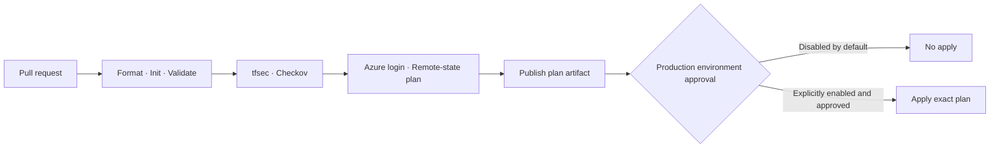

# Azure DevOps Terraform Pipeline

A Windows self-hosted-agent-compatible Azure Pipelines example for Terraform format checks, validation, tfsec, Checkov, remote-state planning, plan artifacts, and an explicitly disabled production apply stage.

> The included Terraform example creates an Azure resource group only if someone deliberately enables the protected apply stage and approves it. No Azure resources are provisioned by this repository or by local validation.

## Workflow



## Agent requirements

- Windows self-hosted Azure DevOps agent registered in the `Terraform_pool` pool
- `TerraformInstaller@1` task available to the organization
- Python 3.12 and `tar.exe` available on the agent
- Network access to HashiCorp releases, PyPI, Chocolatey, Azure, and the configured state storage endpoint

The pipeline uses `PowerShell@2` with `pscore` for scripts and Windows-compatible paths. The included installer downloads a pinned tfsec release from the official GitHub release, verifies its published SHA-256 checksum, and extracts it to the agent temp directory.

## Configure Azure DevOps

1. Create an Azure Resource Manager service connection using workload identity federation where supported. Grant it only the Azure permissions needed for this lab.
2. Create a private Azure Storage account and blob container for Terraform state outside this pipeline. Enable secure transfer and appropriate network restrictions. Grant the service connection's identity the required blob data-plane role, typically **Storage Blob Data Contributor**.
3. Add pipeline variables for `azureServiceConnection`, `stateResourceGroup`, `stateStorageAccount`, and `stateContainer`. These values are names, not credentials. Set the variables through the pipeline UI or an authorized variable group; never put secrets in YAML.
4. Leave `enableProductionApply` as `false` while learning and while permissions are reviewed. For Azure Repos Git, configure `main` branch policies with this pipeline as required build validation; YAML `pr:` triggers are not supported for Azure Repos Git. To protect the apply stage, configure the Azure DevOps `production` environment with approvals/checks, restrict who can approve, and protect the branch.
5. Review the service connection's authorization and pipeline permissions. Do not grant access to all pipelines by default.

The pipeline intentionally skips `Plan` until the service connection and backend names are configured. The `Validate` stage is independent of Azure credentials. A successful validation run is not evidence of an Azure deployment.

## Pipeline behavior

- `Validate`: installs pinned Terraform, Python Checkov, and tfsec; runs formatting, backend-free initialization, validation, and both security scanners.
- `Plan`: runs only after validation and configuration; uses `AzureCLI@2` for authenticated backend initialization and creates a binary plan artifact.
- `ProductionApply`: disabled unless `enableProductionApply` is explicitly set to `true`; additionally requires the `production` environment's configured checks. It applies the exact plan artifact from the same run.

Terraform plan artifacts can contain sensitive values even when the source files do not. Restrict pipeline/artifact access, use an appropriate retention period, and never publish plans to public artifacts or commit them to Git.

Pin changes to tool versions should be reviewed and tested. Scanner findings fail the validation stage; do not suppress findings just to pass CI. Resolve issues or document an approved exception in the relevant project.

## Local validation

From the repository root in PowerShell:

```powershell
terraform fmt -check -recursive
Set-Location infra
terraform init -backend=false
terraform validate
```

The local commands do not authenticate to Azure or provision resources. Run scanners locally only after installing the versions listed in `azure-pipelines.yml`.

## Troubleshooting

- **Plan stage skipped:** set the service connection and all state resource/container variables.
- **AzureCLI authentication failure:** check service-connection authorization and federated identity settings.
- **Backend access denied:** verify the identity's blob data role, storage firewall, and container/key configuration.
- **TerraformInstaller task missing:** install/authorize the Terraform task extension for the Azure DevOps organization.
- **Scanner install fails:** verify Python/tar availability and outbound access from `Terraform_pool`.
- **Apply stage skipped:** expected by default; check `enableProductionApply` and the `production` environment approvals only after review.
